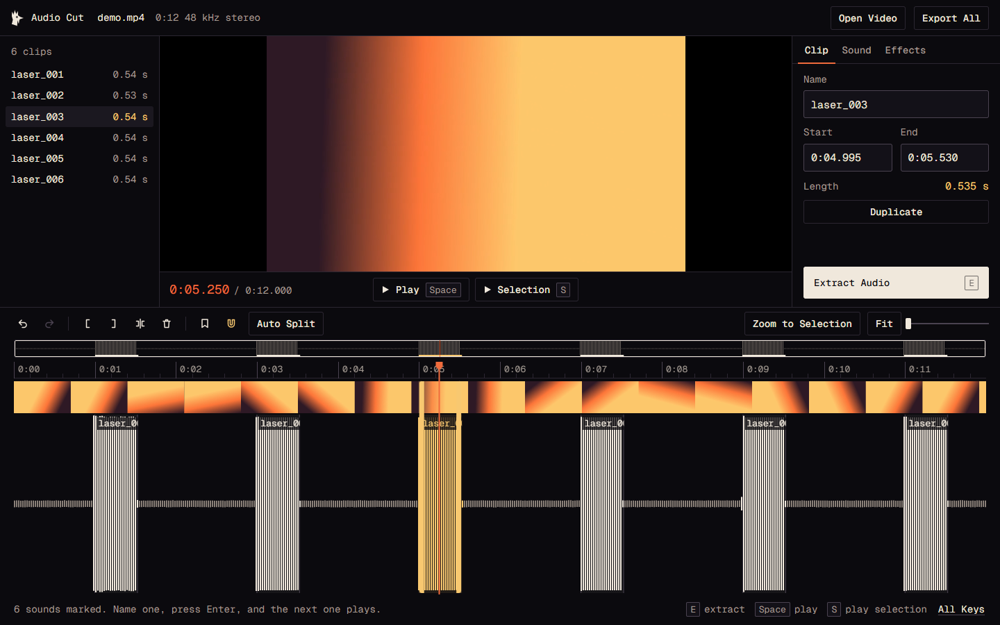

# Audio Cut

Cut sound out of a video, right in your browser.

Drop in a video, drag across a sound, press `E`, type a name, press Enter. That's the whole method, and you have a WAV or MP3 in your downloads. Your video never leaves your computer. There's no account, no upload and no install.

I built this because I had a 4 minute screen recording full of sound effects for a game, and I needed each one as its own named file. Got a lot of them? Auto Split marks every sound for you, then you type a name, press Enter, and the next one plays.

## Try it

1. Download this repo (the green **Code** button, then **Download ZIP**) and unzip it.
2. Open `index.html` in Chrome or Edge.
3. Drop in an mp4, mov or webm.

There's nothing to build. Firefox and Safari aren't tested yet, and they can't read every video format.

## What it does

**Cutting**
- The waveform is always your whole recording, and nothing gets chopped or moved
- Drag across a sound to select it, then drag the handles or type exact times
- Drag again to replace your selection. Once you extract or name it, it stays marked
- Double click a sound to select all of it and hear it
- Auto Split marks every sound in a file, with a live count as you adjust it
- Video frames above the waveform, snapping, markers, undo and redo
- Your clips save themselves and come back when you open the same video again

**Sound**
- Volume, fade in, fade out
- Speed from 0.25x to 4x (pitch moves with it)
- Reverse
- Normalize, which puts a clip's loudest point at -1 dB
- Noise reduction, low cut, high cut and reverb

**Export**
- WAV or MP3
- Extract one clip, join several into one file, or get every clip as its own file in a zip
- Drag clips up and down the list to set the order they join in

What you hear in preview is exactly what you export, because both run through the same code.

## Keys

| Key | Does |
| --- | --- |
| Drag | Select a sound (drag again to replace it) |
| Double click | Select the whole sound and play it |
| `E` | Extract the selection |
| `Space` | Play or pause the recording |
| `S` | Play the selection with its settings |
| `I` / `O` | Set the start or end at the playhead |
| `Delete` | Delete the selection (the recording is untouched) |
| `Ctrl B` | Split the selection at the playhead |
| `Ctrl Z` / `Ctrl Shift Z` | Undo and redo |
| `Ctrl A` / `Ctrl D` | Select all clips, duplicate |
| `Up` / `Down` | Previous or next clip in the list |
| `Alt Up` / `Alt Down` | Move a clip up or down the list |
| `Left` / `Right` | Step the playhead (`Shift` for one second) |
| `M` / `N` | Add a marker, turn snapping on or off |
| `Z` / `Shift Z` | Zoom to the selection, fit the recording |
| Scroll | Zoom (`Shift` or `Alt` to move along the recording) |

Use `Cmd` for `Ctrl` on a Mac.

## How it works

It's plain HTML, CSS and JavaScript with no framework and no build step.

- `js/sound.js` handles everything to do with samples: decoding, finding sounds, rendering a clip, and writing WAV, MP3 and ZIP files.
- `js/app.js` is the editor. A clip is only a marked stretch of the recording plus its settings, so edits never touch your video and undo is cheap.
- `js/sun.js` is the first screen. Move your mouse over the horizon.

The audio decodes to 48 kHz with the Web Audio API. Each clip renders once through an `OfflineAudioContext`, and playback and export both use that result.

## Limits

- Files over about 2 GB are too big for a browser to read in one go.
- It works on one video at a time.
- It exports audio only. For editing the video itself, use a video editor.

## Credits and license

Made by Nicolo Gallia.

The code is under the [MIT License](LICENSE). The MP3 encoder and the fonts have their own licenses, and the Gallia name and rooster logo aren't covered by the MIT License. See [NOTICE.md](NOTICE.md).
